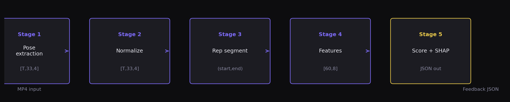
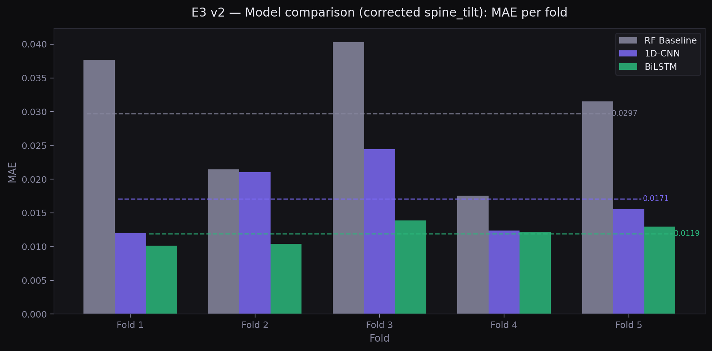
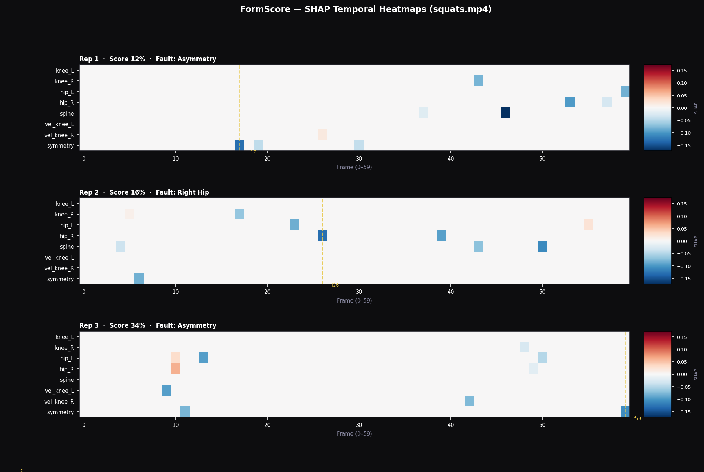

# FormScore: AI Exercise Form Coach

Scores exercise form from video using MediaPipe BlazePose pose estimation, a BiLSTM sequence model, rule-based biomechanics, and SHAP explanations. Supports squats, push-ups, and shoulder presses.



## How it works

1. **Pose extraction:** MediaPipe BlazePose extracts 33 landmarks per frame. It was chosen over RTMPose after benchmarking (12.5 ms vs. 42.1 ms per frame, rep-segmenter F1 0.85 vs. 0.80).
2. **Normalization:** coordinates are centered and scaled by torso height, so scores do not depend on camera distance or body size.
3. **Rep segmentation:** each repetition is detected from the hip, wrist, or shoulder signal depending on the exercise.
4. **Features:** a [60 × 8] tensor per rep built from joint angles, angular velocity, symmetry, and spine alignment.
5. **Scoring:** a BiLSTM score is combined with rule-based biomechanical checks (0.8 × model + 0.2 × rules).
6. **Explanation:** SHAP shows which features at which frames drove the score, so feedback names the fault (for example, knee tracking at a specific frame).

## Data

1,834 labeled reps (720 squats, 388 push-ups, 726 shoulder presses) derived from synthetic motion-capture data with ground-truth joint rotations, so no hand labeling was needed.

## Results

Five-fold GroupKFold cross-validation on squat reps:

| Model | MAE | R² |
| --- | ---: | ---: |
| Random Forest (summary features) | 0.0297 | 0.788 |
| 1D-CNN | 0.0171 | 0.950 |
| **BiLSTM** | **0.0119** | **0.977** |



- **Feature ablation:** the full [60 × 8] feature set reduced MAE by 17% compared with joint angles alone.
- **Synthetic to real transfer:** only a 4.4% mean score drop on real BlazePose detections.
- **Bug found through explainability:** SHAP exposed a spine-tilt feature error; fixing it improved BiLSTM MAE by about 15%.
- **Live scoring:** SHAP runs in a background thread, so live scoring stays fast.



## Run it

```bash
cd formscore
docker compose up --build
```

Then open http://localhost:8501 and upload a video or use the live camera feed. More details are in [formscore/README.md](formscore/README.md).

## Limitations

- The model is trained on synthetic data. Fine-tuning on 119 hand-labeled real reps did not generalize well (R² 0.18), mainly because there were too few labels.
- Rule-based thresholds are not validated across a diverse population.

## My role

Team project. My contributions:

- **Data collection and setup:** sourced and organized the synthetic motion-capture dataset and derived the 1,834 labeled reps used for training.
- **Preprocessing:** pose extraction, coordinate normalization, and rep segmentation that turn raw video into model-ready sequences.
- **Streamlit web app:** built the video upload and live-feed interface together with a teammate.
- **Team support:** helped across the rest of the project, including model training, evaluation, and integration.

Full write-up: [description.pdf](description.pdf) · Slides: [slides.pdf](slides.pdf)
